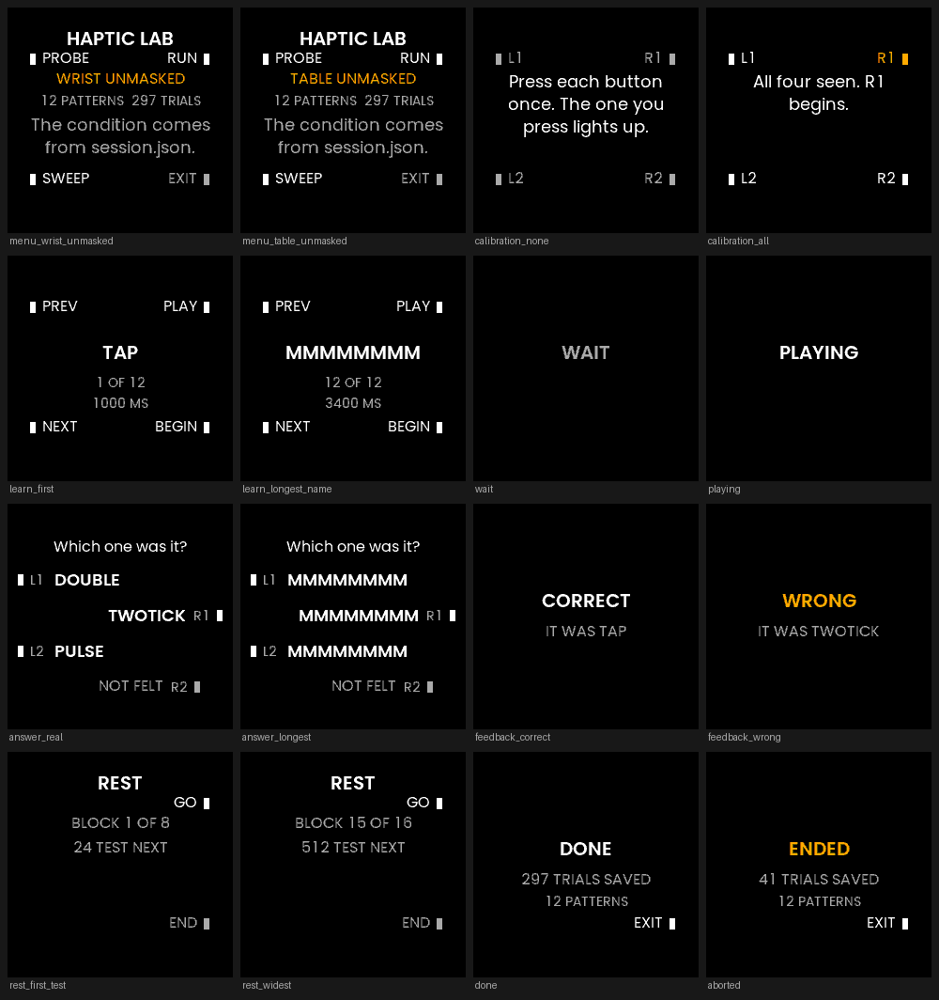

# HapticLab: how many haptic patterns can one wrist tell apart?

An instrument, not an app. It plays a vibration pattern, offers three names,
records which button you pressed, and keeps every clock and every press behind
the answer. Its deliverable is not something anybody uses; it is a vocabulary,
with the pairwise confusion behind every entry and the protocol that produced
it, so another wrist can be added later.

> Unofficial. Not affiliated with, endorsed or sponsored by UNA Watch Ltd.

**Phase 0 has run on the watch; nothing else has.** Every perceptual number
this app will ever produce has to come from a hardware session, and none has
happened.
[`Docs/LEDGER.md`](Docs/LEDGER.md) §0 is the state of the instrument and
[`Docs/VOCABULARY.md`](Docs/VOCABULARY.md) is the deliverable, currently
refusing to answer. What is built and checked is the instrument: the vibro
surface is mapped, the candidate set generated and well formed, the protocol
driven end to end, every screen drawn and disc-masked, the run directory
written and closed out, and the report generated from the files.

## Why it exists

`Nudge` is an eventual product: route navigation you feel, screen off, where
left, right, off-route, back-on-route and arriving are distinct haptic
*phrases* rather than distinct lengths of the same buzz. Whether that product
can exist depends on one number nobody has, and it is not "the watch supports
127 effects". It is the size of the largest group of patterns whose members are
mutually confused below a stated rate, at a stated confidence, on one wrist.

If the answer turns out to be four, that is a real and useful answer, and
`Nudge` should be designed for four.



Each frame above came out of the same `render()` the watch calls, then had the
corners outside the bezel blacked out. **The SDK simulator draws the full
240×240 square with no bezel, so a clipping mistake is invisible there.**
In `Barcode` it reached the watch twice before it was caught. The masking is done
by the `preview` binary, and it reports the ink it found outside the disc:
across every scene in the list, **0 px**.

## What the platform actually gives you

The whole app-facing haptic surface is one message. `SDK::Interface::IVibro` is
not reachable, because `IKIP::IntfID` has no vibro identifier, so
`RequestVibroPlay` is it: **eight notes, played once**, with none of the
interface's loop counts. Ledger rows V1 and V2.

Three consequences shape everything else.

**There is no way to stop a pattern early** (V3) and **no way to learn when one
ended** (V4): a completed `RequestVibroPlay` means accepted, never finished. So
the app *models* each pattern's duration and Phase 1 measures the actuator to
check the model. Until it has, an unmeasured effect is modelled at 1000 ms.
That is a ceiling rather than a guess, taken from `ALERT_1000MS_100`, the longer
of the two effects whose own names state a duration.

**The gaps in the effect enum may or may not be an intensity axis** (V6). The
named entries are 1, 4, 7, 10 and so on, and the skipped ones are exactly the
indices a
three-level amplitude ladder would occupy. That is consistency, not evidence,
so the candidate set comes in two variants: one that needs no amplitude axis
and one that does, and Phase 0 decides which is worth running.

**The GUI is a Rust renderer behind CustomGUI, not TouchGFX, and that is a
measurement decision** (P2). The SDK's TouchGFX port turns `EventButton` into a
key code, forwards only `CLICK`, `PRESS` and `RELEASE`, and discards the
event's own `timestamp`. Reaction time has to come from the kernel's clock
rather than from an app's read of the time at handling, so the port that keeps
it is the one this app uses. A CustomGUI also has the whole `SDK::Kernel`, so
the GUI half plays the patterns itself.

## How the app is split

The GUI half owns the experiment: the protocol, the screens, the buttons, the
four clocks and every file a session writes. The Service half owns Phase 1 and
nothing else, because a GUI process cannot reach a sensor.

| Where | What it holds |
| --- | --- |
| [`Software/Libs/Header`](Software/Libs/Header) | Everything that decides what gets played and what the answer is, free of SDK types: the effect table, the candidate set, the trial plan, the protocol state machine, the row formats, the frame builder and Phase 1's arithmetic. |
| [`Software/Libs/Header/Analysis`](Software/Libs/Header/Analysis) | The statistics. Host-only `double` arithmetic; neither watch ELF includes it. |
| [`Software/Apps/CustomGUI`](Software/Apps/CustomGUI) | `Gui.cpp`, and the Rust renderer with its own tests and its host previewer. |
| [`Software/Libs/Sources`](Software/Libs/Sources) | The two halves' SDK-facing code: `Recorder.cpp` for the GUI, `Service.cpp` for the sweep. |
| [`Tests`](Tests) | The host suite, and `hapticlab-analyse`, which is the report generator built from the same headers the tests hold. |

## The screens, and the one hazard the brief did not name

The wearer is standing, arm down between trials, possibly wearing masking
headphones, and has to absorb each instruction in one glance. Instruction
quality is not polish: an ambiguous prompt shows up later as noise nobody can
separate from perceptual error.

Every instruction is a literal in one place, `MESSAGES` in the renderer, and
the frame selects one by *id*. The frame carries no prose at all. That is not
tidiness: it means the wrap test and the round-screen test enumerate exactly
the strings the watch draws, rather than a second copy of them that could
drift. The prose box itself is the one `Docs/TEXT.md` measured for `Barcode`:
x 20, width 200, 24 px line pitch, centred, white, up to four wrapped lines,
Regular 18.

**The response layout is the part that took the most work.** The obvious design
puts one alternative per screen corner to mirror the four buttons, and it is
wrong twice over: there are no corners on the glass, and two eight-character
pattern names on one row near the rim are 256 px against a 191 px chord. The
first attempt anchored each label inboard of a mark on its button's diagonal,
which is what `Spin` does; `Spin` gets away with it because its hint words are
short, and here the labels landed on top of each other.

So each response gets **a row of its own**, on its button's side of the disc,
with its button's name beside it. Read downwards they are L1, R1, L2, R2,
which is the button order, so the side, the vertical position and the name all
say the same thing. A wearer who is wrong about which button they pressed
contaminates every confusion number with response error rather than perceptual
error, which
is also why a session cannot start until all four buttons have been pressed on
a calibration screen that lights each one as it is pressed.

The marks are solid fills straight into the framebuffer. The bezel indicator
bitmaps blit corrupt on device (P15), and this is the app where that matters
most.

**And the hazard the brief did not name: the presentation window has to be the
same length for every pattern.** If the screen says PLAYING for exactly as long
as the pattern lasts, its duration reaches the wearer through the glass rather
than the wrist, and duration is one of the axes being measured. So the window
is derived once, as the longest modelled pattern in the set plus a margin, and
every trial uses it. `ThePresentationWindowCoversTheLongestPatternInTheSet` and
`TheResponseWindowOpensAFixedTimeAfterTheAsk` are what hold it. The same
reasoning is why the backlight is held on for the whole session rather than
turned on at each presentation, and why the WAIT and PLAYING screens carry
nothing at all. A screen with the alternatives already on it invites an answer
to a pattern that has not finished.

## The candidate set

The set is data, not code, and a row of `patterns.csv` describes the pattern
that was played without reference to the generator. Two variants:

| Set | Patterns | Axes | Why |
| --- | --- | --- | --- |
| `rhythm-and-family` | 12 | waveform character, pulse count, rhythm, length | Nothing in it depends on ledger row V6 holding, so it can be run before Phase 0 answers. |
| `with-amplitude` | 16 | the above plus two intensity-only siblings of `TAP` and two ramps | Exists so the experiment can report that intensity alone fails, which is why the intensity-only pairs are in it rather than left out. |

Twelve is the default because it is learnable in one sitting and still well
above the four to eight items a wrist display is likely to support: the set has
to be able to be larger than the answer. The expectation on record is that
**rhythm carries most of the discriminability and intensity very little**
(ledger row H2), stated so the results can refute it. The set was not designed
to confirm it.

Pattern names are at most eight characters and upper case, which is what the
response rows can draw; the crate's test holds the widest possible name against
the chord at each row.

## The protocol

Absolute identification, three alternatives plus a miss key. Three patterns are
offered in a fixed screen order, the triple's own ascending order, which
cannot depend on which was presented. One is played, and the wearer presses
the button of the one they believe it was. R2 is **NOT FELT**, so a missed
presentation is recorded as a miss rather than forced into a wrong answer.
There is no hold anywhere in the protocol: `enMusicControl` makes the system eat
`HOLD_1S` (P3), and a response scheme resting on a hold would rest on that
being disabled.

A window that closes with nothing pressed is a *different* result from the miss
key, and the two are separate columns. A press during playback is recorded with
its own disposition, because it is evidence the wearer decided before the
pattern finished, which is a real result about that pattern and is invisible if
only accepted responses are kept.

### The open decision: where the intensity axis gets tested

Phase 0 left three options, and the choice costs wrist time rather than code.

1. **Run `rhythm-and-family` and leave intensity alone.** Twelve patterns, about
   42 minutes, and the intensity question stays answered only as "not on
   clicks". This is the default.
2. **Rebuild the four `with-amplitude` patterns on the bump ladder** (7, 8, 9
   instead of 1, 2, 3) and run the sixteen. Gives intensity a fair test on the
   waveform where the step is perceptible, at over an hour of trials.
3. **Test the bump ladder on its own.** A three-pattern set of BUMP, BUMPMID
   and BUMPLOW answers the intensity question in roughly ten minutes without
   inflating the main set. Needs a third `SetId`, which is a small change.

Option 3 is the better experiment and option 1 is the cheaper one. Nothing is
decided.

### Getting past three

Many overlapping triples, balanced so every pair co-occurs a comparable number
of times, and the pairwise confusion matrix is built from the trial record
afterwards. The answer is then the largest set whose every internal pair
confuses below threshold, which is a maximum clique on a small graph and is
brute-forced in the report generator rather than on the watch.

The arithmetic that sizes a run: **a triple use is worth three trials to each
of its pairs**, one per member presented with both on the screen throughout,
and the analysis refuses a pair with fewer than twelve trials behind it. So a
pair needs four triples, which is where the default of four passes comes from.

The planner does not draw a fixed number of triples. It keeps going until
*every* pair has been offered at least `passes` times, because drawing the
fixed count left some pairs covered once where others were covered three
times, and a pair covered once has three trials against a twelve-trial floor.
Running to the floor costs about four extra triples and turns "probably
balanced" into a guarantee.

Presentation order is interleaved by most-remaining rather than shuffled and
repaired: the repair pass was the first attempt and left repeats at the tail,
where every remaining trial was the same pattern. Adaptation to one pattern
would otherwise be measured as identification of it.

### What a run costs

Measured from the real planner at the default pass count:

| Set | Triples | Trials | Blocks | Pair trials |
| --- | --- | --- | --- | --- |
| `rhythm-and-family` | 92 | 300 | 13 | 12 to 18 |
| `with-amplitude` | 163 | 521 | 22 | 12 to 15 |

At the nominal 1000 ms per effect the presentation window is 3800 ms, so a
trial is about 7.8 s of wall clock with the inter-trial interval and a
response, and the twelve-pattern run is about 42 minutes including rests. The
sixteen-pattern run is over an hour, which is why twelve is the default.

**Phase 1 shortens this.** The window is derived from the modelled durations,
and the nominal 1000 ms is a ceiling from the only two effects that state one.
A click almost certainly runs far shorter, so a measured duration table cuts
the window and the session with it; `AMeasuredDurationTableShortensTheWindowRatherThanLengtheningIt`
holds that direction. Running the sweep before the first perceptual session is
worth the thirteen minutes it takes.

### The controls

Two, and both are mandatory before any result is believed.

**No contact.** Watch on a table, wearer's arm off it, same protocol,
`"contact": "table"` in the config. Any above-chance accuracy there is leakage
through hearing or sight and invalidates the contact data by exactly that much.
It is the cheapest and most decisive control in the design, and the report
calls it out in as many words when it sees it. The tool also **refuses to pool
a control run with a wrist run**: pooling a control with the data it controls
is the one mistake that would hide the leakage it exists to find.

**Masking.** An LRA at different amplitudes makes different *sound*, and a
rigid case against skin is a speaker. Run the protocol with masking noise over
the ears and without. If accuracy collapses under masking, what was measured is
hearing.

## Phase 1: timing the actuator with the watch's own IMU

Subjective data alone leaves you unable to say whether two patterns were
confused because they feel alike or because one barely played. So the Service
half plays each effect index and listens to the actuator through the case.

It subscribes to **`FUSION_RAW` at a 10 ms period**, which is a deliberate
departure from the brief's `ACCELEROMETER_RAW`. The reason is measured: the six
IMU captures `Squash` pulled off this watch on 2026-09-03, about 35 minutes of
real wrist data, deliver **99.52 Hz with a 10 ms modal gap and a 36 ms worst
gap** at exactly that request, against the 48.48 Hz an accelerometer
subscription gives. A requested period is not what you get (a 100 ms ask is
snapped to 80 ms), so asking at the bottom of the ladder matters. Ledger rows
S1 to S3.

What it yields is onset, offset, duration and a relative energy proxy from the
sample-to-sample difference, per effect, with the baseline measured from a
quiet window before each play so the threshold is this wrist at this moment.
**It is not the waveform.** An LRA carrier is well above 99.52 Hz and aliases;
Nyquist here is 49.76 Hz, and no report may imply otherwise.

The one independent check is that two of the twenty-one named effects state a
duration in their own name, so `effects.csv` carries the declared figure beside
the measured one.

## Recording: a wrist-hour happens once

Assume that in six months somebody will want to ask a question of this data
that nobody has thought of yet, and that the only thing they will have is the
files. So the default is to record it.

One directory per run, under `Runs/<run id>/`, outside any activity tree so a
research input does not ride along with whatever syncs workouts.

| File | What it holds |
| --- | --- |
| `session.json` | The run header, rewritten whole at the close: ids, schema, versions, firmware, kernel ABI, seed, candidate set and its content hash, condition, wrist, watch position, strap tightness, arm posture, ambient temperature, the derived timings, the caps, and both clocks at start and end with an end reason. |
| `patterns.csv` | The set as actually played, fully parameterised down to the note list, so a later change to the generator cannot orphan the run. |
| `trials.csv` | One row per presentation, self-describing. |
| `events.csv` | **Every** `EventButton`, with why it was or was not taken as the response. |
| `commands.csv` | **Every** `RequestVibroPlay` actually sent, note by note. |
| `probe.csv` | Phase 0's answers, so the probe run is data too. |
| `effects.csv`, `imu/e<NNN>.csv` | Phase 1's summary per effect and repeat, and the raw samples behind it with the sensor's own timestamps. |

### The clocks, all of them

There are several different times in a trial and they disagree. Every one is
recorded rather than the differences between them, so a later question about
queue delay or drift is answerable: the tick before the send, the tick at which
the kernel said it had accepted, the app's own modelled end, the tick the
response window was *due* to open, the tick the frame that says so actually
went out, and `EventButton`'s own timestamp. Reaction time is computed from the
frame that went out, because the wearer answers what they can see and the panel
ticks at 10 fps (P13). Wall clock sits beside the monotonic tick on every row,
because wall clock can jump and the tick cannot, and noticing that it did
should be possible.

### Durability

Every row is opened, appended, flushed and closed on its own. Rows arrive
seconds apart so the cost is irrelevant, and the property that matters is that
a session which dies at trial 50 leaves 49 usable trials. A write-mode open
positions the handle at offset zero rather than at the end, so the append needs
an explicit seek (P8). Deleting it fails the tests that hold this.

**A run is closed out on abandon exactly as on completion.** Throwing away a
session does not make the rows less real, so a run that ended early is a run
with an end reason: `completed`, `abandoned`, `stopped-by-kernel` or
`cap-reached`.

The SDK exposes no free-space query (P10), so the caps are self-defence rather
than device awareness. A row is written only if its worst case still fits, and
both the cap and whether it was hit are in `session.json`. The budget, from the
real formatters at their worst case: a trial row is 280 bytes, an event 104, a
command 128, a probe 134. The widest run is 521 trials, so `trials.csv` peaks
near 146 KB and `events.csv` near 163 KB at three events a trial, against a
1 MB per-file cap. The sweep is the big one: 127 effects at two repeats is
about 79 000 raw samples, near 5 MB, against an 8 MB cap.

## Phase 4: the report, and refusing to overclaim

`hapticlab-analyse` regenerates the whole report from the files, so every
number is recomputable and disagreeable-with. It produces the pairwise
confusion matrix with a Wilson interval on every cell, information transfer in
bits against the stimulus entropy, the maximum distinguishable set at a stated
threshold, accuracy by block so learning is separable from discriminability,
and reaction time by pattern, because a pattern identified slowly is a poor
navigation cue even when it is identified correctly.

It refuses rather than guesses in three places, and each one is held by a test:

- **A pair with fewer than twelve trials gets no rate**, only the shortfall and
  how many more are needed.
- **Membership of the distinguishable set is judged on the interval's upper
  bound, not the point estimate.** One confusion in twelve is not proof of a
  rate under ten percent, and using the point estimate instead is a mutation
  the tests catch.
- **A miss is not evidence that a pair is distinguishable.** Counting a
  presentation nobody felt as a pair trial with no confusion would make every
  pattern in the triple look better for having gone unnoticed.

Training trials are counted by block and kept out of the matrix: they had
feedback after every response, so they are evidence about learning rather than
about confusion.

Wilson rather than the normal approximation because the interesting cells are
the ones with no confusions in them, and the normal approximation gives those a
width of zero.

## Building and running

```sh
export UNA_SDK=/path/to/una-sdk          # an apps-v1.4.0 checkout
Tools/docker-build.sh all                # renderer tests, host tests, the .uapp
Tools/docker-build.sh preview            # one disc-masked PNG per screen
Tools/docker-build.sh analyse Runs/20260908T101500
```

`$UNA_SDK` **has to be an `apps-v1.4.0` checkout.** An app built against a
newer SDK than the running kernel installs cleanly and silently never launches;
see the repository's own [README](../README.md#building).

The current build, in the image this repository's CI pins by digest:
**100 116 bytes, ID `5983D82DFEFF2626`, CRC `0xCA6C206A`**, version 0.1.0,
installed and launched on the watch on 2026-09-09. The GUI's `.bss` is mostly
the 57 600-byte framebuffer plus the 5 672-byte trial plan.

The app appends a line to `/hapticlab.log` at launch and around every run,
carrying its own `BUILD_VERSION`. `Docs/INSTALLING.md` asks every app for that
and this one shipped without it, which is why the first hardware run's one
defect could not be diagnosed from the run it left behind.

There is no TouchGFX simulator here, because there is no TouchGFX: the
renderer's `preview` binary is what a simulator would have been, and unlike the
SDK's it masks the bezel. What a simulator run could tell you about this app is
in any case exactly one thing. `SDK::Simulator::Mock::Vibro` is a logging stub
(P19), so it can verify that a pattern is well formed and nothing else. No
number in `Docs/LEDGER.md` comes from a simulator.

## Configuration

A session's condition comes from a `config.json` written into the app's folder
over USB, because nothing reaches a running app from the phone. See
[`config.example.json`](config.example.json). The condition is drawn on the
menu in amber before the run starts: **a no-contact control recorded as a wrist
run is a ruined session that looks like a real one**, and the screen is the
guard against it.

The seed is recorded whether it came from the file or from the wall clock, so a
run is replannable from `session.json` alone.

## Tests

```sh
Tools/docker-build.sh renderer   # the round panel and the instructions
Tools/docker-build.sh tests      # the protocol, the plan, the rows, the statistics
```

Split on what each one is evidence about. The renderer's tests are the only
ones that see the round panel: nothing drawn outside the disc, nothing past the
chord at its own row, nothing that fits only because the clip removed the end
of it, every instruction inside four wrapped lines with no word lost or split,
and the trial screen identical whichever member of the triple was presented.
The host suite covers what gets played, what gets recorded and what the answer
is; `hapticlab-report-roundtrip` drives the real report generator over a
committed synthetic run, because a renamed column would leave every arithmetic
test green and the report empty.

Both suites have been mutation-checked rather than assumed: moving a hint's
angle, lengthening a label, leaking the presented pattern onto the trial
screen, deleting the append seek, counting a miss as a pair trial and judging
the clique on the point estimate each fail the test that exists to catch them.

## Where the numbers live

- [`Docs/LEDGER.md`](Docs/LEDGER.md): every claim, its tag, and what would
  change it. Nothing enters this repository as a fact without a row.
- [`Docs/PROTOCOL.md`](Docs/PROTOCOL.md): the operator's procedure. On the
  host, not on the watch: four buttons and 200 px of line width is no place for
  a procedure.
- [`Docs/VOCABULARY.md`](Docs/VOCABULARY.md): the actual product of this work,
  and currently a refusal.

## Licence

MIT. See [LICENSE](../LICENSE). Derived from the UNA SDK's MIT-licensed
examples, whose copyright notice is retained there; the derived work is mine.
